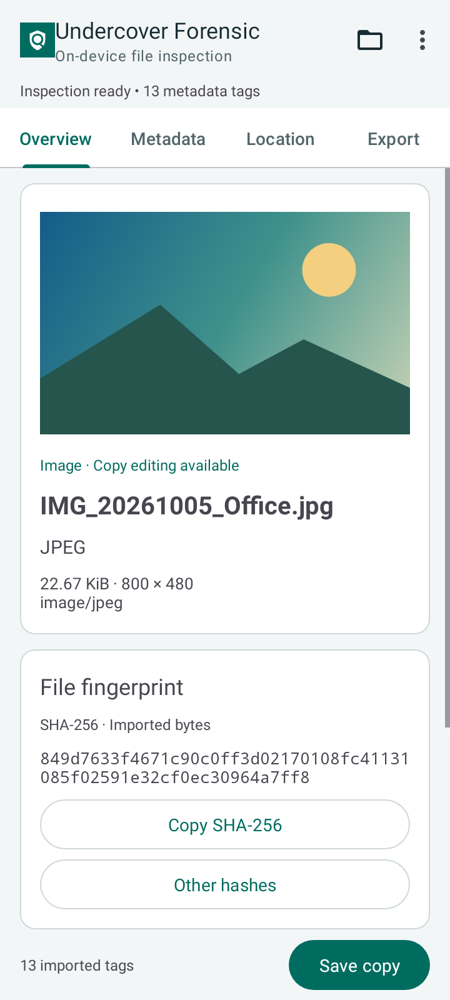
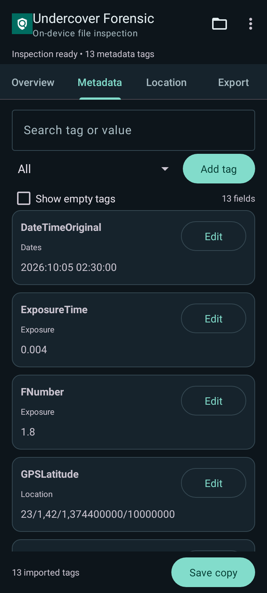
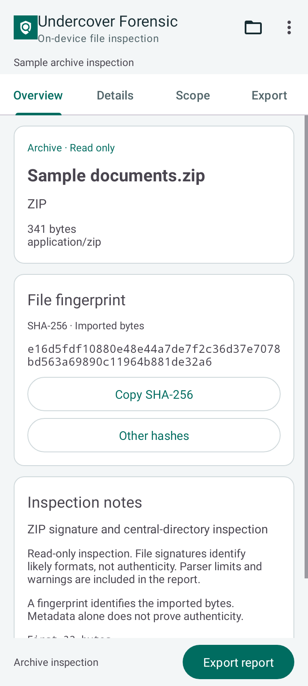
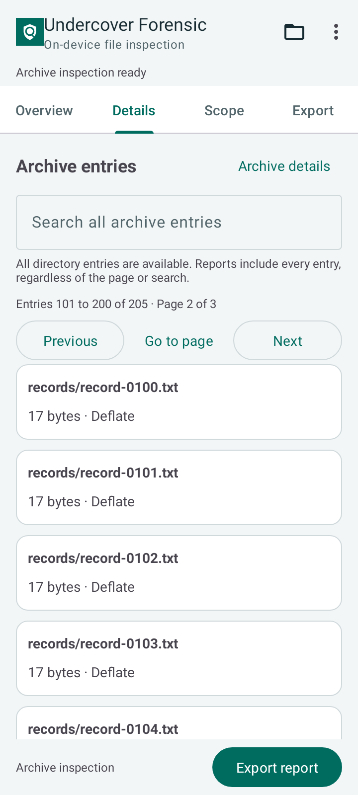
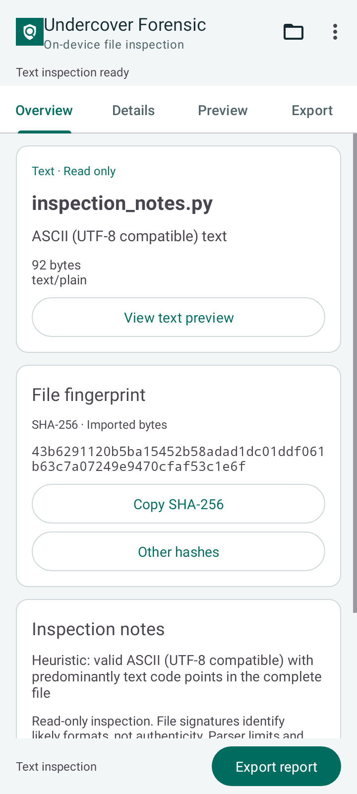
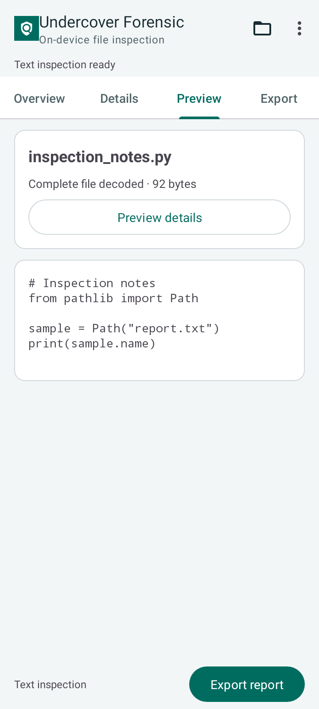

# Undercover Forensic

Inspect files, read metadata and save reports on your Android phone. Undercover Forensic brings image, video, audio, text, PDF and archive inspection into one app.

Built by **Undercover IT Firm**.

## Download

[Download the latest APK](https://github.com/savaskarofficial/Metadata_Forensic/releases/latest)

Requires **Android 6.0 or newer**. Download the APK from the release assets and open it to install. If Android asks, allow installation from your browser or file manager.

## App preview

| Image overview | Image metadata |
| --- | --- |
|  |  |

| File overview | Archive entries |
| --- | --- |
|  |  |

| Text overview | Text preview |
| --- | --- |
|  |  |

## What it does

- Opens files with any extension. TXT, Markdown, Java, Python, JSON, XML, CSV, logs and other text files can be checked without running their contents.
- Shows text encoding, line endings, line counts and a readable preview. Hidden controls and text direction characters are marked in the preview.
- Examines binary samples with a hex preview, byte counts, entropy and readable strings with their file offsets.
- Calculates SHA-256 for imported files. MD5 and SHA-1 are also available for comparison with older records.
- Checks file signatures and shows the first 32 bytes. Unknown formats still get hashes and a JSON report.
- Reads available video and audio metadata, including duration, dimensions, bitrate, stored tags and track details.
- Shows PDF versions, page counts and stored title, author, creator, producer and date fields when available.
- Browses ZIP directory entries in pages, including APK and Office containers such as DOCX, XLSX and PPTX. Search covers the whole inspected entry list.
- Shows image EXIF, camera details, dates, GPS coordinates and embedded thumbnails.
- Edits supported EXIF tags in JPEG, PNG and WebP images, including removing or replacing GPS coordinates.
- Saves edited image copies, clean PNG files and JSON inspection reports.

## Using the app

Open a file to see its type, size and SHA-256 hash. Use Details for file information and Preview to read a text sample. For images, Metadata shows EXIF fields and Location provides GPS controls. Save copy exports image edits. Export report saves the inspection results. The original file stays unchanged.

For archives, use Previous and Next to browse entries. Each page holds up to 100 entries. Searching covers all inspected entries, and Export report includes the full inspected inventory regardless of the page or search currently shown.

Use SHA-256 when creating a new record. The comparison hashes are there for matching older records. Reports include the imported file's details, hashes and any inspection limits. Reports can also contain text previews, hex samples and readable strings, so check for private content before sharing them.

## Supported scope

Imports are limited to **150 MiB**. Detailed inspection depends on the file format and your Android device.

Text inspection reads up to 64 KiB and shows a preview of up to 4,096 characters. It recognizes ASCII and UTF-8, plus UTF-16 and UTF-32 with a byte order mark. Counts describe the inspected sample when a file exceeds the limit. Extensions such as `.md`, `.java`, `.py` and `.python` provide a file type hint, not proof of its contents. Code is not executed, and Markdown and HTML are shown as plain text. Other encodings may receive only basic file information and hashes.

Binary inspection examines up to 64 KiB. It shows the first 256 bytes in hex and lists up to 20 readable ASCII strings with their offsets. Byte counts and entropy describe the sample; they do not establish whether a file is encrypted or malicious.

Video and audio inspection reads stored metadata and track descriptions. Basic MP4 and WAV header details are also available. Media files are not edited. PDF page counts and stored properties are available for supported files up to 32 MiB. Larger PDFs still get file hashes and header details. PDF text, attachments and digital signatures are not inspected.

ZIP and ZIP64 inspection reads the full central directory of single-file archives within the import size limit. Damaged or unsupported directory records produce a partial inventory with a warning. Duplicate-name checks cover the first 4,096 entries; all inspected entries remain available for browsing and export. Entry contents are not extracted, and their CRCs are not verified. Other recognized archive, database and executable formats may show only signature or header details. Large reports need enough free space for a temporary copy before you save them.

Image editing is limited to supported JPEG, PNG and WebP metadata. Clean PNG export supports up to 24 megapixels and flattens animation and HDR. Removing metadata does not remove anything visible in the picture.

## Privacy

Files are processed on your device. The app has no Internet permission and works on a private copy of the selected file. Maps, external links and cloud storage providers open through other apps.

## Support

[Report an issue](https://github.com/savaskarofficial/Metadata_Forensic/issues) or contact me on [Telegram](https://t.me/savaskarofficial). Include your Android version, phone model and what went wrong. Check sample files and reports for private details before sharing them.

## Credits

Developed by **Sharodshahi Al-Amin**, Undercover IT Firm.

The app uses AndroidX, Material Components, Kotlin libraries, PDFBox-Android and Bouncy Castle. Third-party credits and licenses are included in [THIRD_PARTY_NOTICES.txt](THIRD_PARTY_NOTICES.txt).

This repository contains documentation and APK releases. Application source code is private.
